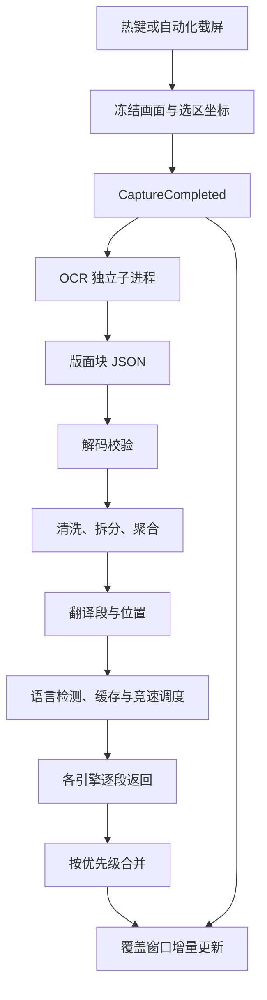

# 项目审核与识别质量改进依据

## 产品与实现范围

本文的问题复现与首轮全量测试记录对应 beta.2 之后的审核快照。beta.3 已修复的问题和最新验收见 `ocr-quality.md`，仍需处理的技术债见 `technical-debt.md`。

LSTtranslate 是 Windows 上常驻托盘的翻译工具。1.1.0 将系统下限扩展到 Windows 10 22H2 x64，界面与 Windows 11 共用实现。截屏翻译与双语互译是两个独立入口：截屏翻译把同一段文字交给多个引擎竞速，双语窗口使用用户选中的一个服务。竞速的优先级由配置决定，数值越小，优先级越高；先返回的译文先显示，更高优先级的译文到达后替换当前结果。

该审核快照的项目版本为 `0.2.0-beta.2`。截屏蒙版、覆盖窗口、文字选择、混合缩放坐标换算、OCR 引擎管理、模型下载、设置、存储位置迁移和应用内更新均有实现。首次运行引导只覆盖本地翻译模型下载，GPU、CUDA、Ollama 检测与首个引擎配置仍列为未实现功能，见 `lst/ui/onboarding/__init__.py`。

该快照中的开发版与自动化接口、OCR 丢块修复、识别保真度测试当时尚未提交。本文保留首轮审核依据，当前发布状态以 `1.1-readiness.md` 为准。

## 架构与职责

主程序使用 Python 3.13、PySide6 Widgets 和 qasync。Qt 界面与 asyncio 共用主线程事件循环。模块通过事件总线传递命令、事件和状态，组合根负责创建模块、连接依赖、启动与停止资源。

| 层或模块 | 职责 | 主要入口 |
|---|---|---|
| contracts | 消息、数据结构与端口协议 | `lst/contracts/` |
| kernel | 事件总线、订阅与模块生命周期 | `lst/kernel/bus.py`、`module.py` |
| app | 组合根、推理进程监管、路径、迁移与自动化服务 | `lst/app/bootstrap.py` |
| services/ocr | 识别结果校验、结构归一化与分段 | `lst/services/ocr/module.py` |
| workers/ocr_worker | Windows OCR、RapidOCR、PaddleOCR 后端 | `lst/workers/ocr_worker/` |
| services/race | 语言检测、任务打包、并发调度、结果合并与取消 | `lst/services/race/scheduler.py`、`merger.py` |
| services/engines | 本地翻译、词典、在线翻译与大模型接口 | `lst/services/engines/registry.py` |
| ui | 托盘、截屏、覆盖窗口、双语窗口和设置 | `lst/ui/` |

业务层与内核通过依赖检查约束，不导入 Qt；推理子进程不依赖业务层、界面层或组合根。自动化客户端只依赖标准库，安装版启动器能够直接运行它。八项依赖约束全部通过。

### 截屏翻译的数据流

截图使用 BGRA 像素帧，位置使用相对截图左上角的物理像素。覆盖窗口另外维护 Qt 逻辑坐标和当前屏幕的设备像素坐标。修改识别框时必须保持这一坐标约定，缩放后的 OCR 坐标由后端换算回原图。

新截图以会话号隔离旧结果。OCR 模块、竞速模块和覆盖窗口分别检查会话归属。识别进程同时只执行一个任务，新截图使旧请求失效；翻译调度按引擎实例控制并发与批量大小。

### 推理、配置与存储

OCR 与本地神经机器翻译分别运行在独立进程。监管器负责握手、加载、请求排队、超时、崩溃重启与配置重载，Windows 作业对象负责主进程退出后的子进程清理。PaddleOCR 与主环境依赖隔离，Windows OCR 使用主环境，RapidOCR 使用独立 OCR 环境。

配置服务以 Pydantic 模型校验各节，通过原子写入保存 TOML，并发布带修订号的配置状态。进程级参数触发重载，请求级参数随下一次识别发送。API key 存入系统凭据管理器。译文缓存与竞速统计使用各自的 SQLite 数据库，数据库操作放在后台线程。

数据目录迁移使用 SQLite 备份接口复制数据库，跳过 WAL 等旁文件；模型目录迁移先停止相关进程，再移动文件并写入配置，失败时回滚。普通版和开发版共享实现，自动化接口的默认开关由构建类型决定；显式保存过的用户设置优先。应用内更新按构建类型匹配安装包与 SHA-256 校验文件。

## 已核实的问题

### 配置修改的回执会被其他修改提前触发

位置：`lst/app/automation/methods.py` 的 `update_config`，尤其是 `on_config`。

该方法把任意更大的配置修订号当作本次修改已经完成。两个客户端同时修改不同配置节时，先完成的修改会唤醒两个等待者。

使用真实 `ConfigService` 并发提交以下修改即可复现：

1. 将 `general.theme` 从 `system` 改为 `dark`。
2. 将 `ocr.language` 从 `auto` 改为 `en`。

两个调用均返回 `changed: true` 和 `revision: 2`，第二个调用返回的 OCR 值仍为 `language: auto`。配置服务随后完成第二次写入，最终文件中的值为 `en`。因此，自动化调用返回成功时，该次修改尚未完成。

这会影响连续调参：客户端在收到成功回执后立即截屏，识别请求会使用旧参数。修复应让回执关联本次请求，覆盖成功、拒绝和无变化三种结果；只观察全局修订号不足以确认单次写入。

### 失败后重试成功，自动化记录仍保持失败

位置：`lst/app/automation/recorder.py` 的 `SessionRecord.phase`、`on_ocr_completed` 和 `on_ocr_failed`。

`on_ocr_failed` 保存失败对象，`on_ocr_completed` 更新识别结果时保留该失败对象。同一会话先接收 `OcrFailed`、再接收成功的 `OcrCompleted` 后，`phase` 仍为 `failed`，结果中的 `error` 仍是第一次失败。

同一会话的重试还会遇到 `settled` 的提前结束：旧失败已使记录进入已定状态，`wait_result` 会立即返回。修复应覆盖重试开始、成功和再次失败的完整生命周期，并重置对应的失败、进度和完成时间。

### 界面截图中的独立文字单元被合并

位置：`lst/services/ocr/paragraphs.py`、`normalize.py` 和 `segments.py`。

附加组件截图的 PaddleOCR 版面结果把左侧菜单组成一个范围为 `[102, 46, 400, 877]` 的段，把右侧热门列表组成一个范围为 `[1402, 51, 1704, 702]` 的段。覆盖窗口按整个段的范围重新排版，原有菜单项的纵向位置随之改变。

文本模式也存在独立单元粘连。RapidOCR 的结果将扩展名称、分类和评分合成 `Extract 'Em! Import/Export ★★★★★(21)`；博客顶部的五个导航项被合成一个段。当前几何合并器主要判断中线、间距、行高与水平重叠，同一列中紧邻的不同控件会满足这些条件。

这类问题同时涉及识别后的结构处理。检测阈值决定哪些文字框进入结果，分段规则决定哪些文字共同翻译和排版；两个环节需要分别评估。

### 参考图尚未形成质量回归测试

位置：`tests/fidelity/`。

该目录有两组原图与参考图，以及真实引擎调用和结果缓存工具。`pipeline.py` 已定义期望标注文件路径，但目录中尚无 `*.expected.json`，也没有 `test_*.py`。当前工具打印段数与识别耗时，尚未计算文字准确率、文字单元召回率、粘连率、拆分率或位置误差。

新增质量断言应以人工核对的文字单元为基准。单元标注需要区分正文段落、菜单、标题、分类、评分、计数与按钮，并保留各单元在英文原图中的位置。评分星形和图标中的文字还需要单独标记，避免把图形误识别计入正常文字。

### 管道请求长度上限存在边界遗漏

位置：`lst/app/automation/server.py` 的 `_read_line`。

该方法先查换行符，再检查缓冲区长度。超出 1 MiB 的请求若在最后一块数据中同时带上换行符，会直接返回该行。向缓冲区放入 `1,048,577` 字节内容和换行符后，方法返回了超限内容。

长度校验应同时覆盖完整行与尚未收完的行。现有超长请求测试发送的内容没有换行符，覆盖的是后者。

### 入口文档与实现状态不一致

`readme.md` 仍将版本写为 `0.1.0`，并称截屏蒙版和覆盖窗口尚未实现。其双语窗口说明仍采用“Ctrl+Enter 让计费引擎加入”的描述，与当前需求中双语窗口只使用选中服务的规则不同。

`tests/fidelity/pipeline.py` 另有两处超过行宽限制，且格式检查要求重排该文件。类型检查通过，代码规范检查尚未全部通过。

## 参考图的验收口径

两组图片应按对应文字单元比较。英文原图与繁体中文参考图采用不同视口和裁剪范围，整图逐像素差值会把页面自身的重排计入识别误差。

| 页面 | 测试目录中的英文原图 | 测试目录中的参考图 |
|---|---|---|
| 博客 | 1908 × 1150 | 2000 × 1031 |
| 附加组件 | 1827 × 924 | 1766 × 1137 |

当前附件中的博客参考原图为 2219 × 1144，测试目录中的版本经过缩放。后续标注应记录所用文件与坐标基准，避免将两份参考图的位置混用。

识别质量应分别衡量文字内容、文字单元边界、单元位置和字号层级。翻译质量需要另外评估；版面实验可使用固定的人工译文，使翻译措辞保持一致。

覆盖窗口的现有需求 `OV-02` 明确要求模糊底图，并按整体亮度使用黑字或白字。参考网页中的蓝色链接、原网页背景与字体颜色属于另一套显示方式。当前验收可比较文字完整性、布局位置与层级；若要保留网页原配色，需要同时调整渲染需求和实现。

## 验证结果

全量测试收集 4426 项，执行结果为 4412 项通过、13 项跳过、1 项失败。失败项为 `tests/workers/test_ct2_backend.py::test_warmup_model_counts_against_lru_capacity`：模型解压临时目录改名时出现 Windows 拒绝访问错误。随后单独复查整个 `test_ct2_backend.py`，58 项全部通过。首次目录改名失败的根因仍需定位。

跳过项包括按需开启的截图检查、当前 Qt 平台不支持的深浅色检查，以及 CUDA 不可用时的显卡测试。真实 PaddleOCR、RapidOCR、Windows OCR 与可用的本地翻译进程测试均已进入本次全量执行。

严格类型检查结果为 0 个错误、0 个警告。依赖检查分析 328 个文件、1954 条依赖，八项约束全部通过。Ruff 检查发现 `tests/fidelity/pipeline.py` 的两处超长行，格式检查要求重排同一文件。

审核初期保留了原有业务代码与未提交改动。随后已修复配置回执、重试记录和管道长度边界，并完成参考图标注与识别改进；后续结果见 `docs/ocr-quality.md`。本文的问题分析保留首次复现的原因与影响。

## 修改涉及的完整链路

新增识别参数需要核对主进程配置模型、`worker_settings` 与 `request_options`、子进程设置解析和后端实际调用。设置页根据字段元数据生成控件，参数名称、范围、默认值与是否重载进程需要保持一致。只修改界面显示值会造成参数看似生效、推理仍沿用旧值。

识别结果解码器拒绝额外字段。若扩展文本行或版面块的数据结构，需要同时核对 contracts、子进程输出序列化、主进程解码、分段与渲染；若信息只在主进程内部使用，应明确它与跨进程格式的关系。业务层继续遵守与 Qt 的依赖边界。

识别流程图按真实处理步骤列出节点。增加归一化步骤或改变步骤顺序时，设置页的 `flow_specs.py`、相关说明与流程测试需要同步。覆盖窗口的文字选择和绘制共用 `QTextLayout`，字号或换行的调整也需要检查字符位置、跨段选择和缩放后的命中测试。

## 改进顺序

1. 修复配置回执与识别重试记录，使调参工具可靠反映实际状态。
2. 完成人工标注，建立当前各引擎的内容与分段基线。
3. 分别调整检测尺寸、检测阈值、识别模型与语言设置，记录准确率和耗时。
4. 改进独立控件与连续正文的区分，在参考图和既有段落样本上共同验证。
5. 使用固定译文检查字号、换行、遮挡与可选择文字，并将质量下限写入回归断言。

Windows OCR 的 `auto` 使用系统用户语言列表选择识别器。英文页面基准应显式指定 `en`，多语言自动选择应单独测试，避免将识别语言变化混入参数比较。
